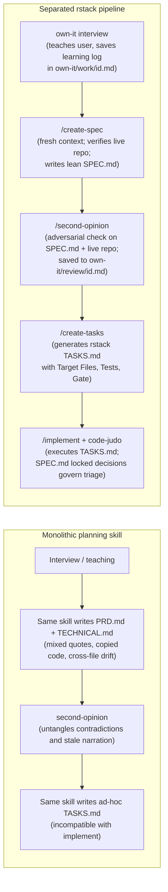

# Backend technical specification practices for frontier coding agents

This note separates **source-backed observations** from 2025-2026 agent engineering and classic design-doc primary sources from an **rstack synthesis** for a lean backend specification template and `create-spec` skill. External sources were fetched and verified on **2026-11-23**.

## 1. Executive summary and core thesis

A modern backend specification for frontier coding agents is a **lossless knowledge-transfer artifact** passed from a planning agent to downstream reviewing, taskifying, implementing, and verifying agents. Its job is to store only the decisions, external contracts, non-repository runtime facts, invariants, open-question gates, and verification oracles that a fresh agent cannot re-derive by reading the codebase.

It is **not** a tutorial, a teaching transcript, a guided tour of existing code, or a step-by-step implementation manual. Frontier coding agents read repositories directly and navigate symbols on demand. Restating what the repository already contains adds token bloat, introduces factual drift, and burns the model's finite attention and instruction budgets without improving task resolution.

Five primary-source findings anchor this thesis:

1. **Redundant codebase descriptions hurt efficiency and can lower pass rates.** Gloaguen et al. ([arXiv:2602.11988](https://arxiv.org/abs/2602.11988), Feb 2026) evaluated repository context files across SWE-bench Lite and 138 real developer-committed tasks in CTXbench. Context files did not generally improve task resolution rates (LLM-generated files dropped resolution by 0.5% on SWE-bench Lite and 2% on CTXbench; developer-written files averaged +2.4%, p=0.21), while increasing inference cost by over 20% and reasoning tokens by 10% to 22%. Codebase overviews did not help agents reach target files faster when repo docs already existed.
2. **Input length and topically related distractors degrade accuracy across all frontier models.** Chroma's *Context Rot* report ([Hong et al., Jul 2025](https://research.trychroma.com/context-rot)) evaluated 18 models (including Claude 4, GPT-4.1, Gemini 2.5, and Qwen3) and showed consistent performance decline as input length grows, even when task complexity stays constant. Topically related distractors (such as conversational brainstorming or superseded options mixed into active specs) degrade accuracy more than unrelated text and compound with length.
3. **Instruction adherence decays with constraint count, failing mainly by silent omission.** Jaroslawicz et al. ([IFScale, arXiv:2507.11538](https://arxiv.org/abs/2507.11538), Jul 2025) tested 20 models from 10 to 500 simultaneous instructions. Even top frontier models scored at most 68% at 500 instructions. Reasoning models hold steady up to roughly 150 to 250 constraints before sharp variance and decline, while non-reasoning models decay linearly or exponentially. Primacy bias peaks around 150 to 200 instructions, and failures shift overwhelmingly to silent omission.
4. **Over-specifying implementation details upfront cascades errors downstream.** Anthropic's *Harness Design for Long-Running Application Development* ([Mar 2026](https://www.anthropic.com/engineering/harness-design-long-running-apps)) deliberately restricted its planner agent to product context and high-level technical design, because granular technical mistakes in an upfront spec cascade into downstream implementation. OpenAI's *Harness Engineering* ([Feb 2026](https://openai.com/index/harness-engineering/)) states the same rule: enforce boundaries and invariants centrally, and leave local implementation choices to the agent.
5. **External facts and verifiable oracles are the highest-leverage spec content.** OpenAI notes that anything outside versioned local artifacts (chat decisions, ticket clarifications, staging probe outputs) effectively does not exist to a fresh agent ([Harness Engineering](https://openai.com/index/harness-engineering/)). Both Anthropic ([Effective Harnesses for Long-Running Agents, Nov 2025](https://www.anthropic.com/engineering/effective-harnesses-for-long-running-agents); [Claude Code Best Practices](https://www.anthropic.com/engineering/claude-code-best-practices)) and OpenAI show that concrete, executable verification criteria prevent premature victory far better than emphatic prose.

## 2. Common failure modes in agent-authored specs and `rstack` pipeline needs

### Five recurring defects in conversational / dual-file specs

When a single planning or teaching skill tries to interview the user, write `PRD.md`, write `TECHNICAL.md`, and emit tasks in one run, five structural defects show up repeatedly:

1. **Teaching transcripts leak into binding contract sections.** Copying raw user interview answers and agent corrections into the spec places conversational distractors directly beside binding invariants.
2. **Splitting single-service specs across `PRD.md` and `TECHNICAL.md` causes cross-file contradictions.** Unconfirmed stakeholder questions get written as settled decisions in one file while sitting in open questions in the other; serialization or nullability rules drift between the two documents; resolved questions accumulate as strikethrough sediment.
3. **Mandatory code snippets and line numbers bloat context and rot immediately.** Pasting 100+ lines of existing handlers, DTOs, and OpenAPI schemas burns tokens, encourages manual narration bugs (wrong route paths, stale assumptions against outdated sibling branches), and goes stale on the next commit.
4. **Monolithic acceptance prose hides impossible or vague checks.** Cramming unit tests, serialization assertions, log-redaction rules, live checks, and stakeholder sign-offs into one 250+ word paragraph masks unverifiable or contradictory criteria.
5. **Incompatible task schemas break downstream execution.** When an upstream planning skill emits its own ad-hoc `TASKS.md` (missing `Target Files`, `Tests`, `Pre-review gate`, and `Status: PENDING`), `/implement` cannot drive it without manual rework.

### What `rstack` downstream skills actually read and require

Inspecting `rstack` (`skills/implement/SKILL.md`, `skills/create-tasks/SKILL.md`, `skills/second-opinion/SKILL.md`, `PLAN.md`, and `specs/template/`):

| Downstream skill | Files it reads | Exact inputs it requires from the spec folder | Notes from primary source |
|---|---|---|---|
| `second-opinion` | Every document in the spec folder plus referenced files | Clear problem/scope/success (Vision), verifiable repo claims (Assumptions), explicit failure/concurrency/empty states (Edge cases), single source of truth without contradictions (Alignment), checkable criteria (Verifiability), discriminating design parameters (`to-theory`) | Filename-agnostic. Single file eliminates cross-doc contradictions in Category 4. |
| `create-tasks` | Reads whatever exists in the spec directory (`SPEC.md`, `PRD.md`, `ARCHITECTURE.md`, optional `DESIGN.md`, `INTEGRATION.md`, plus decisions and open questions) | (1) Problem/scope, business rules, out-of-scope, **verifiable acceptance criteria**; (2) system fit, data/contract changes, **touch map / naming table**; (3) cross-layer contracts if any; (4) accepted decisions and unresolved questions (excluded from tasks) | Reads host repo code after reading specs so `Target Files` reflect real code. |
| `implement` | Reads only `TASKS.md`; consults specs/ADRs only to triage `code-judo` review rejections | Does not depend on spec filenames. Requires `TASKS.md` with `Pre-review gate`, `Target Files`, `Tests`, `Success Criteria`, `Status: PENDING`. During review triage, a `code-judo` finding can only be rejected by citing a **recorded decision** (spec, ADR, user decision, or repo pattern) | Forbids referencing spec paths, task numbers, or planning prose in code, tests, or commits. |

### Pipeline flow: monolithic vs. separated `create-spec`



## 3. What to keep vs. what to omit (the knowledge-transfer filter)

Every token in a spec competes for attention and instruction-following capacity. Apply one filter to every candidate paragraph: **Can a fresh frontier coding agent re-derive this accurately by reading the target repository?**

- If **no** (decisions, rejected alternatives, external wire contracts, non-repo runtime probes, fault-isolation policy, security/logging bans, stakeholder blockers, verification oracle), **keep it** in the spec.
- If **yes, with a quick lookup** (which class handles a route, which module owns a mapper), **point, do not copy** (name the path or symbol once without pasting code or line numbers).
- If **yes, trivially or irrelevantly** (standard framework mechanics, step-by-step coding recipes, existing untouched code, conversational interview history, resolved questions), **omit it**.

### Empirical and primary-source backing

- **Keep context tight and high-signal.** Anthropic defines effective context engineering as finding *"the smallest possible set of high-signal tokens that maximize the likelihood of some desired outcome"* and operating at the *"right altitude"* between brittle hardcoded steps and vague goals ([Effective Context Engineering, Sep 2025](https://www.anthropic.com/engineering/effective-context-engineering-for-ai-agents)).
- **Do not duplicate repository overviews or code.** Gloaguen et al. ([arXiv:2602.11988](https://arxiv.org/abs/2602.11988), Section 4.2) found that codebase overviews in context files did not reduce steps to locate target files when repo documentation existed, while adding 20% to 23% cost. Anthropic's *Claude Code Best Practices* lists *"Describe your architecture and file layout"* under **What you can stop doing**: *"Claude reads the repo itself. Only write down what isn't in there"* ([Claude Code Best Practices](https://www.anthropic.com/engineering/claude-code-best-practices)). Matt Pocock's `writing-for-agents` calls restating the repo a stale *"cache"* (`vendor/mattpocock-skills/skills/productivity/writing-for-agents/SKILL.md`), and `to-spec` bans specific code snippets unless a snippet encodes a schema or state machine more precisely than prose (`vendor/mattpocock-skills/skills/engineering/to-spec/SKILL.md`). Malte Ubl gives the exact same rule for Google design docs: rarely include code or full schema copy-pastes; focus on design trade-offs ([Design Docs at Google, Jul 2020](https://www.industrialempathy.com/posts/design-docs-at-google/)).
- **Avoid copying existing code into plans because agents confuse descriptions with tasks.** Birgitta Böckeler observed in GitHub Spec Kit that pasting descriptions of existing classes into spec/research markdown caused the coding agent to ignore that they already existed and regenerate duplicate classes ([Understanding Spec-Driven-Development, martinfowler.com, Oct 2025](https://www.martinfowler.com/articles/exploring-gen-ai/sdd-3-tools.html)).
- **Stay well below the instruction saturation cliff.** IFScale ([Jaroslawicz et al., Jul 2025](https://arxiv.org/abs/2507.11538)) shows that even reasoning models degrade sharply past 150 to 250 simultaneous constraints, and non-reasoning models degrade linearly from the start, dropping later constraints by omission. Because the coding agent already loads system prompts, `AGENTS.md`, skills, and tests, a feature spec should carry **10 to 30 sharp, non-redundant constraints**, never 100+ micro-instructions.
- **Keep distractors and superseded history out of active specs.** Chroma's *Context Rot* ([Jul 2025](https://research.trychroma.com/context-rot)) demonstrated that topically related distractors trigger abstention in Claude models and hallucination in GPT models. Strikethrough resolved questions, abandoned drafts, and verbatim interview confusion act as topically related distractors.
- **Record rationale and rejected alternatives so downstream agents do not reverse decisions.** Michael Nygard's ADR essay ([Nov 2011](https://www.cognitect.com/blog/2011/11/15/documenting-architecture-decisions)) explains that without recorded forces and consequences, a later reader either blindly accepts stale choices or blindly breaks invariants. In `rstack`, `implement` (`skills/implement/SKILL.md`) explicitly uses recorded spec decisions as the basis for rejecting `code-judo` findings that would otherwise undo an intentional trade-off. Oxide RFD 1 ([Frazelle & Cantrill](https://rfd.shared.oxide.computer/rfd/0001)) similarly prioritizes viable options, reasoning backed by data, and explicit document state.
- **Use structured behavioral syntax (EARS or Given/When/Then) selectively for testable clauses.** Alistair Mavin's EARS syntax (`While <state>`, `When <trigger>`, `If <unwanted condition> Then <system> shall <response>`) reduces ambiguity and wordiness in event-driven and fault-handling requirements, and works particularly well when authors write in English as a second language ([Official EARS Guide](https://alistairmavin.com/ears/)). Kiro adopts EARS in `requirements.md` for this reason ([Kiro Feature Specs](https://kiro.dev/docs/specs/feature-specs/)). However, Mavin et al.'s own IEEE RE'09 evaluation warns that EARS reduces ambiguity but **does not prevent omitted requirements** ([Mavin et al., IEEE RE 2009](https://dl.acm.org/doi/10.1109/RE.2009.9)), and Böckeler warns that forcing verbose EARS/User-Story ceremony onto small changes creates review overload ([martinfowler.com, Oct 2025](https://www.martinfowler.com/articles/exploring-gen-ai/sdd-3-tools.html)). Use crisp Given/When/Then or `When / If...Then` bullets only for binding behavioral rules and failure modes, not for trivial boilerplate.

### The knowledge-transfer decision matrix

| Content category | Action | Why (source-backed) | Generic backend example (`order-orchestrator`) |
|---|---|---|---|
| Problem, user/caller, and measurable goal | **Keep** (2-4 sentences) | Prevents wrong-problem solutions (`second-opinion` Vision; [Anthropic Mar 2026](https://www.anthropic.com/engineering/harness-design-long-running-apps)) | Checkout needs per-item hazardous-shipping advisories; `order-orchestrator` must propagate `shippingAdvisories` from `shipping-gateway` to `checkout-web` |
| Explicit scope and plausible non-goals | **Keep** | Stops scope creep and prevents agents from "fixing" deferred bugs ([Google Design Docs](https://www.industrialempathy.com/posts/design-docs-at-google/); `create-tasks` rules) | Out of scope: bulk quote endpoint `/quotes/batch`, new backend feature flag, pre-existing cache-invalidation bug on `PUT /orders/{id}` |
| Locked architectural decisions + rejected alternatives | **Keep** | Prevents `implement` and `code-judo` from reversing intentional trade-offs ([Nygard ADR](https://www.cognitect.com/blog/2011/11/15/documenting-architecture-decisions); [Oxide RFD 1](https://rfd.shared.oxide.computer/rfd/0001); `implement/SKILL.md`) | Reuse Call 1 and single Redis entry; bind `shippingAdvisories` as raw JSON tree (`JsonNode`) because typed list deserialization wipes shipping rates on upstream type drift |
| External wire contracts, nullability, and delta payloads | **Keep** (delta only) | Downstream/upstream schemas often live in other repos or unbuilt branches ([OpenAI Harness Eng.](https://openai.com/index/harness-engineering/)) | 5-field table for `shipping.advisories`, `carrierCode` `nullable: true`, `tags: null -> []`, empty state always `[]` |
| Non-repo runtime & operational facts | **Keep** | Inaccessible to any agent reading only the target repo ([OpenAI Harness Eng.](https://openai.com/index/harness-engineering/)) | Staging probe results showing optional items return `[]`; `checkout-web` calls `.join(', ')` on `tags` without a null guard |
| Cross-cutting boundaries (fault isolation, security/PII, caching, concurrency, observability) | **Keep** (as crisp invariants) | Primary source of production incidents in backend services ([Google Design Docs](https://www.industrialempathy.com/posts/design-docs-at-google/); [Oxide RFD 1](https://rfd.shared.oxide.computer/rfd/0001); `second-opinion` Edge cases) | Parse `advisories` per entry; never log long notice text or raw parser `e.getMessage()`; log only `orderId`, count, item SKUs, error class, JSON field path |
| Blocking vs. non-blocking open questions | **Keep** (strictly separated; delete once resolved) | Prevents treating unconfirmed assumptions as locked requirements; avoids distractor sediment ([Context Rot](https://research.trychroma.com/context-rot)) | Stakeholder contract conflicts explicitly block `/create-tasks` until answered; zero strikethrough rows |
| Behavioral clauses and verification oracle | **Keep** | Concrete pass/fail oracles stop premature completion ([Anthropic Nov 2025](https://www.anthropic.com/engineering/effective-harnesses-for-long-running-agents); `create-tasks` `Success Criteria`) | Numbered `R1..R7` clauses + exact test command, log-appender redaction test, wire serialization test, local smoke check |
| Existing repo files, entry points, and new file names | **Point, do not copy** | Just-in-time retrieval beats stale copies ([Anthropic Sep 2025](https://www.anthropic.com/engineering/effective-context-engineering-for-ai-agents)); satisfies `create-tasks` naming table | Compact Touch map naming `ShippingResponse.java`, `AdvisoryParser.java` (new), `OrderService.java`, `openapi.yaml` with 1-line roles, zero line numbers |
| Copied existing code blocks and line numbers | **Omit** | Rots on the next commit, bloats tokens >20% ([Gloaguen et al.](https://arxiv.org/abs/2602.11988)), can trick agents into duplicating classes ([Böckeler](https://www.martinfowler.com/articles/exploring-gen-ai/sdd-3-tools.html)) | Delete verbatim Java/YAML snippets copied from existing repo files |
| Step-by-step coding recipes and framework mechanics | **Omit** | Errors cascade downstream ([Anthropic Mar 2026](https://www.anthropic.com/engineering/harness-design-long-running-apps)); models already know Spring, Jackson, Express, SQL | Do not dictate private helper signatures or loop variable names |
| Conversational teaching Q&A, raw user quotes, resolved-question history | **Omit** (keep in `own-it/work/`) | Distractors degrade recall ([Context Rot](https://research.trychroma.com/context-rot)); user learning notes serve a different audience | Keep raw interview prose strictly in the `own-it` work note |

## 4. File architecture trade-off

Three layouts compete for a feature spec directory:

| Evaluation criterion | Option A: Single-file `SPEC.md` (with optional `INTEGRATION.md` / `DESIGN.md` only when cross-team or UI) | Option B: Two-file `PRD.md` + `TECHNICAL.md` | Option C: Multi-file `PRD.md` + `ARCHITECTURE.md` + `INTEGRATION.md` (`rstack` / Kiro / Spec Kit style) |
|---|---|---|---|
| **Context load and review fatigue** | Lowest. One short file (80-180 lines) read in one pass. Matches `lazy-plan` Rung 4 and Böckeler's critique of multi-file markdown bloat ([martinfowler.com](https://www.martinfowler.com/articles/exploring-gen-ai/sdd-3-tools.html)). | Medium-high. Often grows to 350-450 lines across two files with heavy overlap. | Highest for single-service backend changes. Forces artificial separation between functional rules and technical contracts, which Böckeler explicitly flagged as confusing in Spec Kit. |
| **Contradiction / drift risk** | Lowest. Single source of truth: decisions, contracts, edge cases, and acceptance clauses live in one place (`writing-for-agents` single-source-of-truth rule). | High. Functional promises in `PRD.md` routinely drift from DTO/schema choices in `TECHNICAL.md`. | High unless strict ownership boundaries are policed across 3-4 files; updating one decision often requires editing multiple files. |
| **Compatibility with `second-opinion`** | Full, out of the box. `second-opinion` reads every doc in the folder and audits Vision, Assumptions, Edge cases, Alignment, Verifiability, and `to-theory`. | Full, but spends findings untangling contradictions caused by the two-file split itself. | Full, but reviewer must cross-check 3-4 files for alignment. |
| **Compatibility with `create-tasks`** | Full when `create-tasks` lists `SPEC.md` alongside `PRD.md`/`ARCHITECTURE.md`. `SPEC.md` provides every input `create-tasks` needs (behavioral clauses, touch map, contracts, open questions). | Awkward. `create-tasks` expects Given/When/Then or atomic clauses and a naming table, not prose verification blocks. | Native match to split `PRD.md` + `ARCHITECTURE.md` layouts. |
| **Compatibility with `implement` + `code-judo`** | Full. `implement` drives from `TASKS.md` and checks spec decisions during `code-judo` triage; one `SPEC.md` makes decision lookup instant. | Full (via `TASKS.md`), but triage must check both files. | Full (via `TASKS.md`), with decisions potentially spread across multiple files. |
| **Best fit** | Single-service backend features, endpoint extensions, enrichments, jobs, integrations. | Legacy dual-file workflows; no structural advantage over Option A or Option C. | Multi-repo / cross-team initiatives where UI (`DESIGN.md`) and multi-service contracts (`INTEGRATION.md`) have separate human reviewers. |

### Settled recommendation for `rstack`

**Default to Option A: one `SPEC.md` per feature folder**, paired with `TASKS.md` generated later by `/create-tasks`. Keep `own-it`'s teaching notes completely separate in `own-it/work/<id>.md` and adversarial review reports in `own-it/review/<id>.md`.

**Escalate to extra files only when a distinct human audience or cross-team boundary earns the split** (matching `lazy-plan`'s ladder and `writing-for-agents`'s splitting rule):

- Add `INTEGRATION.md` only when two or more independently owned teams or repos must sign off on a shared wire/event contract.
- Add `DESIGN.md` only when UI flows, copy, or layout change.

## 5. Backend spec template and section guardrails

### Copy-ready `SPEC.md` template

```markdown
---
spec_id: <feature-or-repo--feature>
repo: <product-repo>
base_ref: <branch>@<short-sha>
status: draft | blocked-on-questions | approved
card: <ticket-or-issue-id>
upstream_specs: [<optional sibling spec ids>]
---

# <Feature title>

## 1. Problem and goal
<!-- 2-4 sentences: caller/user problem and observable backend outcome. -->

## 2. Scope and non-goals
### In scope
- <Exact endpoints, consumers, events, or jobs changed>

### Non-goals
- <Plausible goal deliberately excluded, plus deferred pre-existing bugs>

## 3. Locked decisions and rejected alternatives
<!-- Confirmed choices only. Governs downstream code-judo review triage. -->
| ID | Decision | Rejected alternative and reason | Owner / Source |
|---|---|---|---|
| D1 | <Active-voice choice> | <Rejected option + concrete trade-off> | <User / Tech lead / ADR> |

## 4. External contracts and data invariants
<!-- Changed or boundary-crossing shapes, types, nullability, empty states, and normalization rules only. -->
| Field | Source / Wire path | Type & nullability | Empty / missing rule | Notes |
|---|---|---|---|---|

### Contract sample (changed slice only)
<!-- Minimal JSON/Avro/SQL snippet showing only new/changed fields plus empty/failure case. Omit if table alone is unambiguous. -->

## 5. Non-repo facts and operational boundaries
<!-- Only facts a fresh agent cannot read from <repo> alone. Delete unused bullets. -->
- **Upstream / downstream runtime facts**: <Staging probes, sibling-repo quirks, consumer expectations>
- **Fault isolation and degradation**: <What fails independently, fallback output, retry/circuit-breaker rules>
- **Caching, state, and concurrency**: <Cache key, TTL, read vs. mutation behavior, known race semantics>
- **Security, PII, and logging**: <Auth boundary, redaction bans, allowed log fields>
- **Observability**: <Structured log keys, metrics, traces, alertable signals>

## 6. Touch map (pointers, not copies)
<!-- Paths, action, and 1-line role only. No repo code blocks or line numbers. -->
| Path | Action | Responsibility |
|---|---|---|
| `<path>` | modify / new | <1-line responsibility or invariant enforced here> |

**Untouched by design**: `<symbols, routes, or controllers explicitly left unchanged>`

## 7. Behavioral requirements and edge cases
<!-- 6-20 numbered, atomic, testable clauses (EARS When/If...Then or Given/When/Then). Cover happy, empty, partial, malformed, flag-off, and failure paths. -->
- **R1 (Happy path)**: When <trigger>, <system> shall <observable outcome>.
- **R2 (Empty / absent)**: When <missing or empty input>, <system> shall <outcome>.
- **R3 (Malformed / fault isolation)**: If <bad payload or partial failure>, then <system> shall <isolated outcome without breaking critical paths>.
- **R4 (Dependency outage)**: If <upstream fails or times out>, then <system> shall <degraded outcome>.
- **R5 (Feature toggle / cache)**: While <state>, when <trigger>, <system> shall <outcome>.
- **R6 (Logging / security)**: <System> shall never log <forbidden data>; on parse failure it shall log only <allowed fields>.

## 8. Verification oracle
- **Pre-review gate**: `<exact repo lint/test/build command>`
- **Required automated proofs**:
  - <Contract / serialization / schema proof>
  - <Fault-isolation and edge-case proofs mapped to R1..Rn>
  - <Log-redaction / security proof naming exact loggers or appenders>
- **Live / end-to-end proof**: <Exact local verification skill or command and expected observable result>

## 9. Open questions
<!-- Delete resolved rows after promoting them to Section 3. -->
### Blocking (must resolve before `/create-tasks` and `/implement`)
| ID | Question | Owner | Evidence / Conflict |
|---|---|---|---|
| Q1 | <Concrete decision needed> | <Role> | <Why repo, ticket, or stakeholders conflict> |

### Non-blocking (can resolve in parallel or post-ship)
| ID | Question | Owner | Default while open |
|---|---|---|---|
```

### Section-by-section density rules and "Do NOT put here" guardrails

| Section | Target density | Format guidance | Do NOT put here |
|---|---|---|---|
| **Frontmatter** | 6 lines | Set `status: blocked-on-questions` whenever Section 9 has any blocking row. | Narrative summaries or dates of every minor edit. |
| **1. Problem and goal** | 2-4 sentences | State the caller problem and observable outcome in plain English. | Raw interview transcripts, uncertainty filler, or implementation plumbing. |
| **2. Scope and non-goals** | 5-12 bullets total | Name exact routes/jobs in scope; non-goals must be plausible goals explicitly excluded ([Google Design Docs](https://www.industrialempathy.com/posts/design-docs-at-google/)). | Truisms ("must not crash") or multi-paragraph feature wishlists. |
| **3. Locked decisions** | 3-10 table rows | Active voice + rejected alternative + who owns the choice. Governs `code-judo` review triage. | Unconfirmed proposals, `(pending approval)` hedges, or routine coding choices. |
| **4. External contracts** | 1 table + 1-2 minimal JSON slices | Show only added/changed fields, exact wire types, nullability, and empty/failure shapes. | Copy-pasted untouched OpenAPI files or full existing DTO classes. |
| **5. Non-repo facts & boundaries** | 5-10 crisp bullets | Only facts absent from `<repo>`: staging probes, sibling-repo quirks, cache/toggle nuances, redaction bans, fault boundaries. | Standard framework explanations or copies of existing methods from `<repo>`. |
| **6. Touch map** | 4-15 rows | File path, `modify`/`new`, 1-line role. Explicit `Untouched by design` line. | Pasted repo code blocks, line numbers, or private helper method signatures. |
| **7. Behavioral requirements** | 6-20 numbered clauses (`R1..Rn`) | Atomic `When` / `If...Then` (EARS) or `Given/When/Then` clauses; each clause maps cleanly to tests and `create-tasks` `Success Criteria`. | Multi-sentence prose walls or unconfirmed stakeholder wishes. |
| **8. Verification oracle** | 4-8 bullets | Exact build command, specific automated proof targets (naming loggers/serializers), and live verification command. | Vague goals ("ensure high quality", "write thorough unit tests"). |
| **9. Open questions** | Only active items | Split strictly into Blocking vs. Non-blocking. Promote to Section 3 and **delete** the row once answered. | Strikethrough resolved questions or questions already answered by reading the repo. |

### Worked example (generic backend enrichment service)

Compressing a typical ~390-line dual-file spec (`PRD.md` + `TECHNICAL.md` with copied code blocks and mixed interview quotes) into one ~90-line `SPEC.md`:

```markdown
---
spec_id: order-orchestrator--shipping-advisories
repo: order-orchestrator
base_ref: main@a1b2c3d
status: blocked-on-questions
card: ORD-412
upstream_specs: [shipping-gateway--shipping-advisories]
---

# Propagate hazardous-shipping advisories to checkout orders

## 1. Problem and goal
`shipping-gateway` now returns `shippingAdvisories` on `POST /v1/shipping/quote` for regulated SKUs, but `order-orchestrator` drops the field. Propagate those entries under `order.shipping.advisories` through the existing order shipping cache and OpenAPI contract so `checkout-web` can display mandatory carrier notices without risking regressions to rates or delivery windows.

## 2. Scope and non-goals
### In scope
- Order endpoints that already compute or read `shipping`: `GET /orders/{orderId}`, `GET /orders/by-token/{token}`, and item mutations that refresh Redis.
- Redis serialization under existing key `shippingQuote:<orderToken>` and `OrderBase.shipping` in `openapi.yaml`.

### Non-goals
- Summary endpoints (`POST /orders`, `GET /orders/summary`): continue returning `shipping: null`.
- Bulk quote endpoint (`POST /shipping/batch`) and advisory analytics logging (owned by `shipping-gateway`).
- New backend feature flag (follows existing tenant flag `feature_shipping_quotes`).
- Pre-existing bugs outside advisories: concurrent Redis mutation races and 10-minute negative caching on gateway outages.

## 3. Locked decisions and rejected alternatives
| ID | Decision | Rejected alternative and reason | Owner / Source |
|---|---|---|---|
| D1 | Reuse the existing `shipping-gateway` quote call and single Redis entry `shippingQuote:<orderToken>`. | Separate endpoint or second Redis key rejected to avoid extra network hops and dual-cache drift. | Author |
| D2 | Bind `GatewayQuoteBody.shippingAdvisories` as a raw JSON tree (`JsonNode`) and parse entries individually in an isolated parser. | Typed `List<ShippingAdvisory>` rejected because a JSON decode error wipes out shipping rates and caches `[]` for 10 minutes. | Author / `second-opinion` |
| D3 | Preserve `carrierCode` as nullable `String` (`nullable: true` in OpenAPI) and normalize `null` `tags` to `[]`. | Forwarding `null` `tags` crashes `checkout-web`'s `.join(', ')` rendering path. | Author |
| D4 | Never log advisory notice text or raw parser `e.getMessage()`. Log only `orderToken`, count, item SKUs, and (on failure) exception simple class name plus JSON field path. | Lombok `@Data` `.toString()` logging leaks verbose compliance text into centralized JSON logs. | Author / Tech lead |

## 4. External contracts and data invariants
| Field | Source (`shipping-gateway`) | Domain type | OpenAPI type | Empty / null rule |
|---|---|---|---|---|
| `sku` | `sku` (`string`) | `String` | `string` | Required; drop entry if blank |
| `carrierCode` | `carrierCode` (`string`, nullable) | `String` | `string` (`nullable: true`) | Preserve `null` |
| `tags` | `tags` (`string[]`, nullable) | `List<String>` | `array` of `string` | Normalize `null` to `[]` |
| `summaryText` | `summaryText` | `String` | `string` | Pass through |
| `detailText` | `detailText` | `String` | `string` | Pass through (pending Q1 confirmation) |

## 5. Non-repo facts and operational boundaries
- **Upstream (`shipping-gateway`)**: Always sends `shippingAdvisories: []` when no regulated SKUs are present; may emit partial entries with `carrierCode: null` or `tags: null`.
- **Downstream (`checkout-web` `origin/main`)**: BFF forwards `order.shipping` untouched; the notice panel calls `item.tags.join(', ')` without a null check.
- **Flag vs. cache read asymmetry**: `OrderService` reads Redis before checking `feature_shipping_quotes`. Cache-miss reads with flag off return empty shipping without writing Redis; mutations overwrite Redis with `advisories: []`.

## 6. Touch map (pointers, not copies)
| Path | Action | Responsibility |
|---|---|---|
| `src/main/.../GatewayQuoteBody.java` | modify | Add raw `JsonNode shippingAdvisories` |
| `src/main/.../AdvisoryParser.java` | new | Per-entry fault-isolated parser with safe logging and `tags` normalization |
| `src/main/.../ShippingInfo.java` | modify | Add default empty `List<ShippingAdvisory> advisories` |
| `src/main/.../ShippingService.java` | modify | Attach parsed `advisories`, keep safe INFO count/SKU log |
| `src/main/.../QuoteCacheService.java` | modify | Normalize legacy cached entries where `advisories == null` to `[]` |
| `src/main/resources/openapi.yaml` | modify | Add `ShippingAdvisoryResponse` (`carrierCode: nullable: true`) and `OrderBase.shipping.advisories` |

**Untouched by design**: `BatchQuoteController`, `GatewayClient`, `FeatureFlagService`.

## 7. Behavioral requirements and edge cases
- **R1 (Happy path & cache hit)**: When `shipping-gateway` returns advisories for order SKUs, `GET /orders/{orderId}` shall return them in `shipping.advisories`, store them in Redis, and serve subsequent cache hits without calling `shipping-gateway`.
- **R2 (Nullability & normalization)**: When an entry has `carrierCode: null` or `tags: null`, the HTTP JSON response shall emit `"carrierCode": null` and `"tags": []`.
- **R3 (Empty or item removed)**: When `shipping-gateway` returns `[]` or omits `shippingAdvisories`, or when a regulated SKU is removed, `shipping.advisories` shall return `[]` and Redis shall be updated with `advisories: []`.
- **R4 (Legacy cache compatibility)**: When Redis contains a cached `ShippingInfo` missing `"advisories"` or with `"advisories": null`, `QuoteCacheService` shall return `advisories: []`.
- **R5 (Fault isolation)**: If `shippingAdvisories` is not a JSON array or contains an unreadable entry alongside valid entries, then HTTP client decoding shall succeed, only the invalid entry shall be dropped, shipping rates shall return intact, and the parser shall log only `orderToken`, error class, and JSON field path.
- **R6 (No-text logging)**: Neither `ShippingService` nor `AdvisoryParser` shall emit `summaryText` or `detailText` in any log line.

## 8. Verification oracle
- **Pre-review gate**: `mvn verify` in `order-orchestrator`.
- **Required automated proofs**:
  - `AdvisoryParserTest`: single/multiple entries, `carrierCode: null`, `tags: null -> []`, non-array node, mixed valid + malformed entries.
  - `ShippingServiceTest`: happy propagation, flag-off, fault isolation preserving rates, and Logback `ListAppender` test asserting zero notice text leaks on `ShippingService` and `AdvisoryParser`.
  - `QuoteCacheServiceTest`: round-trip with `advisories` and legacy JSON without `"advisories"`.
  - Serialization test: verifies generated OpenAPI DTO emits `"carrierCode": null` and `"advisories": []`.
- **Live proof**: Run local verification harness against staging `shipping-gateway` and dev Redis proving item add, cached read, and item removal.

## 9. Open questions
### Blocking (must resolve before `/create-tasks` and `/implement`)
| ID | Question | Owner | Evidence / Conflict |
|---|---|---|---|
| Q1 | Confirm `checkout-web` expects both `summaryText` and `detailText`, and `advisories: []` when empty. | Frontend dev | Ticket omitted `detailText` and prose asked to omit empty object. |
```

## 6. Skill-authoring takeaways from `rstack`

1. **Invocation mode (`README.md`, `writing-for-agents/SKILL-MECHANICS.md`).**
   - For user-invoked manual handoffs (`create-spec`, `own-it`), set `disable-model-invocation: true` and start `description` with `Use only when ...` so the skill spends zero permanent context load.
   - Omit `disable-model-invocation` only when the agent or another skill must invoke the skill autonomously, using a 1-3 sentence positive-trigger `Use when ...` description.
2. **Split by sequence to stop premature completion (`writing-for-agents/SKILL.md`).**
   - Keep `own-it` focused on teaching/interviewing and saving its learning note (`work/<id>.md`). Hand off across a fresh context boundary to `/create-spec` (synthesis only, zero interview, mirroring `to-spec`), then `/second-opinion`, then `/create-tasks`, then `/implement`.
3. **Inline the template; disclose rare branches (`principle-guard-the-context-window`, `writing-for-agents/SKILL.md`).**
   - Keep the `SPEC.md` template inline inside `create-spec/SKILL.md` because every run uses it.
4. **Enforce a live repo verification gate before writing (`second-opinion`, `create-tasks`, `lazy-plan`).**
   - Verify every route, symbol, config key, build command, and `base_ref` (`<branch>@<short-sha>`) directly against live files on disk; never copy repo code snippets or line numbers into `SPEC.md`.
5. **Enforce checkable completion criteria and positive prompting (`writing-for-agents/SKILL.md`, `authoring-a-skill.md`).**
   - End each stage with an exhaustive check (e.g., zero unconfirmed items in Sections 3 or 7; `status: blocked-on-questions` whenever Section 9 `Blocking` has rows).
   - Prune no-ops and boilerplate; delegate to sibling skills by name/path rather than restating them.
   - Delete unused template subsections instead of writing `"N/A"` (`lazy-plan`).

## 7. Sources

### `rstack` internal files consulted

- `README.md`, `PLAN.md`
- `docs/research/adr-practices.md`, `docs/research/repository-search-practices.md`
- `skills/implement/SKILL.md`, `skills/create-tasks/SKILL.md`, `skills/second-opinion/SKILL.md`, `skills/lazy-plan/SKILL.md`, `skills/create-adr/SKILL.md`
- `vendor/mattpocock-skills/skills/engineering/to-spec/SKILL.md`
- `vendor/mattpocock-skills/skills/productivity/writing-for-agents/SKILL.md` and `SKILL-MECHANICS.md`
- `vendor/pstack/skills/poteto-mode/playbooks/authoring-a-skill.md`
- `vendor/pstack/skills/principle-guard-the-context-window/SKILL.md`
- `vendor/pstack/skills/principle-minimize-reader-load/SKILL.md`

### External primary sources (accessed 2026-11-23)

- Anthropic, [Building effective agents](https://www.anthropic.com/engineering/building-effective-agents), Dec 19, 2024.
- Anthropic, [Claude Code: Best practices for agentic coding](https://www.anthropic.com/engineering/claude-code-best-practices), Apr 18, 2025 (updated 2026).
- Anthropic, [Effective context engineering for AI agents](https://www.anthropic.com/engineering/effective-context-engineering-for-ai-agents), Sep 29, 2025.
- Anthropic, [Effective harnesses for long-running agents](https://www.anthropic.com/engineering/effective-harnesses-for-long-running-agents), Nov 26, 2025.
- Anthropic, [Harness design for long-running application development](https://www.anthropic.com/engineering/harness-design-long-running-apps), Mar 24, 2026.
- OpenAI (Ryan Lopopolo), [Harness engineering: leveraging Codex in an agent-first world](https://openai.com/index/harness-engineering/), Feb 11, 2026.
- OpenAI, [Codex Prompting Guide](https://developers.openai.com/cookbook/examples/gpt-5/codex_prompting_guide).
- Birgitta Böckeler, [Understanding Spec-Driven-Development: Kiro, spec-kit, and Tessl](https://www.martinfowler.com/articles/exploring-gen-ai/sdd-3-tools.html), martinfowler.com, Oct 15, 2025.
- GitHub Blog, [Spec-driven development with AI: Get started with a new open source toolkit](https://github.blog/ai-and-ml/generative-ai/spec-driven-development-with-ai-get-started-with-a-new-open-source-toolkit/), and [`github/spec-kit`](https://github.com/github/spec-kit) (`templates/spec-template.md`, `templates/plan-template.md`).
- Kelly Hong, Anton Troynikov, and Jeff Huber (Chroma), [Context Rot: How Increasing Input Tokens Impacts LLM Performance](https://research.trychroma.com/context-rot), Jul 14, 2025.
- Thibaud Gloaguen, Niels Mündler-Sasahara, Mark Niklas Müller, Veselin Raychev, and Martin Vechev (ETH Zurich & LogicStar.ai), [Evaluating AGENTS.md: Are Repository-Level Context Files Helpful for Coding Agents?](https://arxiv.org/abs/2602.11988), arXiv:2602.11988, Feb 2026.
- Daniel Jaroslawicz, Brendan Whiting, Parth Shah, and Karime Maamari (Distyl AI), [How Many Instructions Can LLMs Follow at Once?](https://arxiv.org/abs/2507.11538) (IFScale), arXiv:2507.11538, Jul 2025.
- Malte Ubl, [Design Docs at Google](https://www.industrialempathy.com/posts/design-docs-at-google/), Jul 6, 2020.
- Jess Frazelle and Bryan Cantrill (Oxide Computer Company), [RFD 1: Requests for Discussion](https://rfd.shared.oxide.computer/rfd/0001).
- Michael Nygard, [Documenting Architecture Decisions](https://www.cognitect.com/blog/2011/11/15/documenting-architecture-decisions), Cognitect Blog, Nov 15, 2011.
- Alistair Mavin, [EARS: Easy Approach to Requirements Syntax (Official Guide)](https://alistairmavin.com/ears/), and Mavin et al., [Easy Approach to Requirements Syntax (EARS)](https://dl.acm.org/doi/10.1109/RE.2009.9), IEEE RE 2009.
- Kiro Documentation, [Feature Specs (Requirements-First & Design-First)](https://kiro.dev/docs/specs/feature-specs/).
